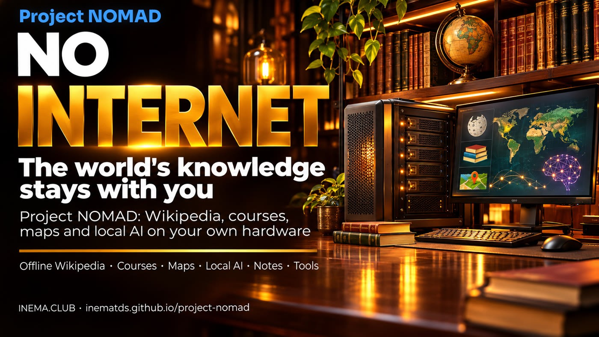

# Project NOMAD (ARCKHÉ fork)

**🇧🇷 [Português](README.md) · 🇺🇸 [English](README.en.md) · 🇪🇸 [Español](README.es.md)**

> ARCKHÉ fork of [Project NOMAD](https://github.com/Crosstalk-Solutions/project-nomad) by Crosstalk Solutions (Apache 2.0). The code is unchanged; the Portuguese/English/Spanish guide lives in `guia/`. The full original README (in English) is [README.md](README.md).

## What it is

What if the internet goes down, or you are somewhere it never reaches? Project NOMAD is a knowledge and education server that runs on your own computer and works without internet. You install it on Linux (Debian or Ubuntu) and open it in the browser: offline Wikipedia and ebooks, Khan Academy courses, maps, a local AI chat, notes and data tools. You only need internet to install it and to download the content you want to keep.

## 📖 Usage guide

Full guide (summary + step by step): **https://linnoff88-dev.github.io/arckhe-/guia/en/**

🎬 Video: coming soon.

Official site: https://www.projectnomad.us
