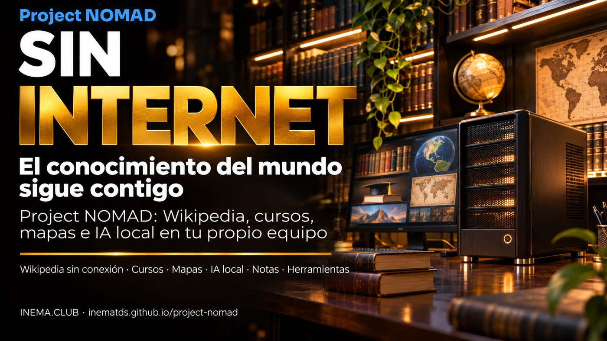

# Project NOMAD (fork de INEMA)

**🇧🇷 [Português](README.md) · 🇺🇸 [English](README.en.md) · 🇪🇸 [Español](README.es.md)**

> Fork de INEMA de [Project NOMAD](https://github.com/Crosstalk-Solutions/project-nomad), de Crosstalk Solutions (Apache 2.0). El código no fue modificado; la guía en portugués/inglés/español está en `guia/`. El README original completo (en inglés) es [README.md](README.md).

## Qué es

¿Y si se cae internet, o estás donde no llega? Project NOMAD es un servidor de conocimiento y educación que corre en tu propia computadora y funciona sin internet. Lo instalas en Linux (Debian o Ubuntu) y lo abres en el navegador: Wikipedia y libros sin conexión, cursos de Khan Academy, mapas, un chat con IA local, notas y herramientas de datos. Solo necesitas internet para instalar y para descargar el contenido que quieras guardar.

## 📖 Guía de uso

Guía completa (resumen + paso a paso): **https://inematds.github.io/project-nomad/guia/es/**

🎬 Video: próximamente.

Sitio oficial: https://www.projectnomad.us
